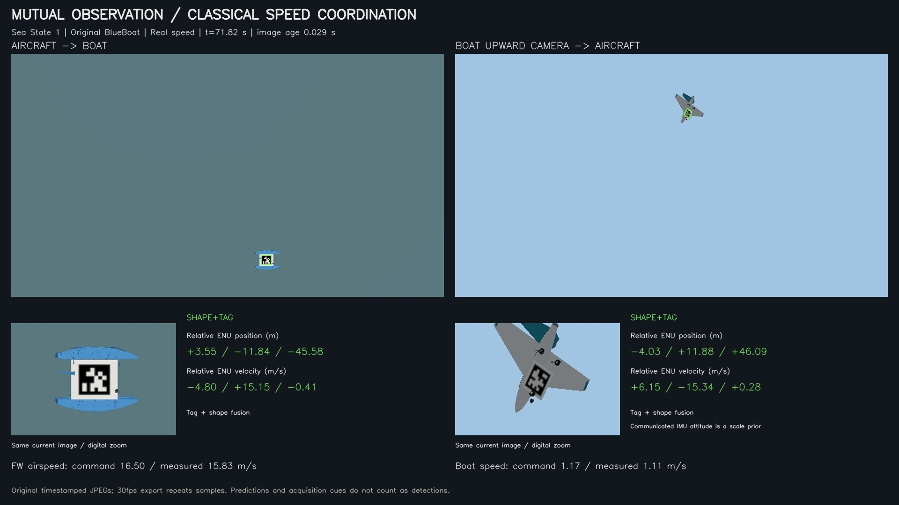
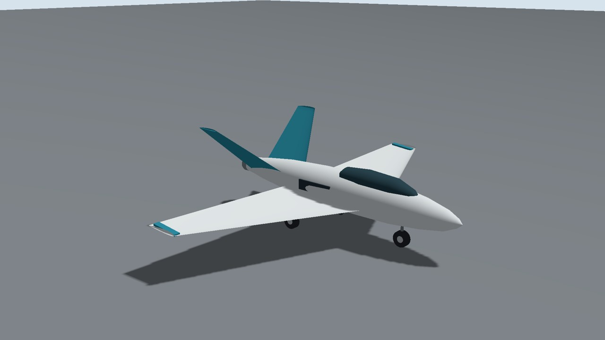
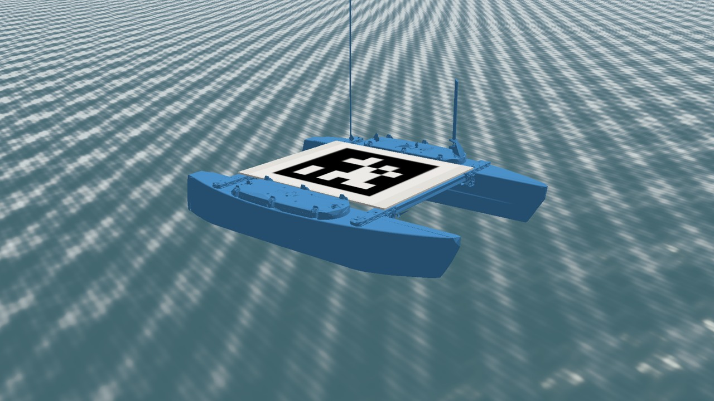
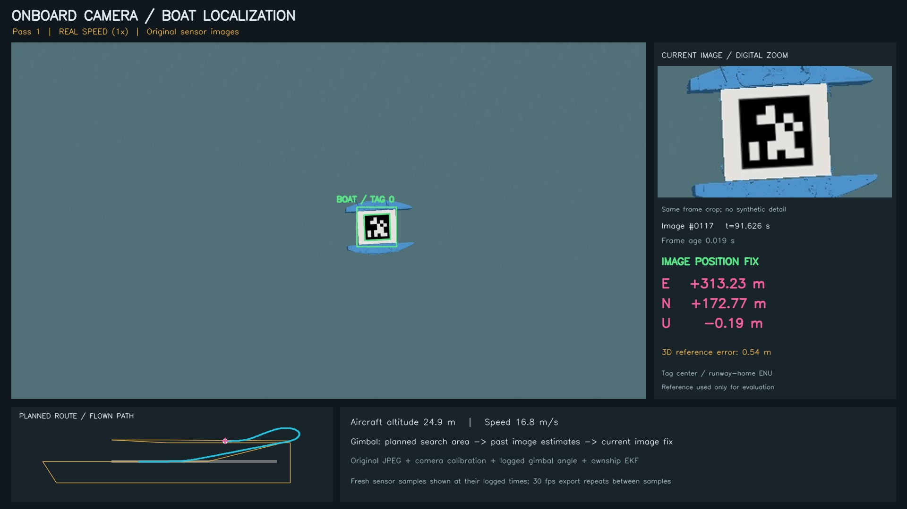
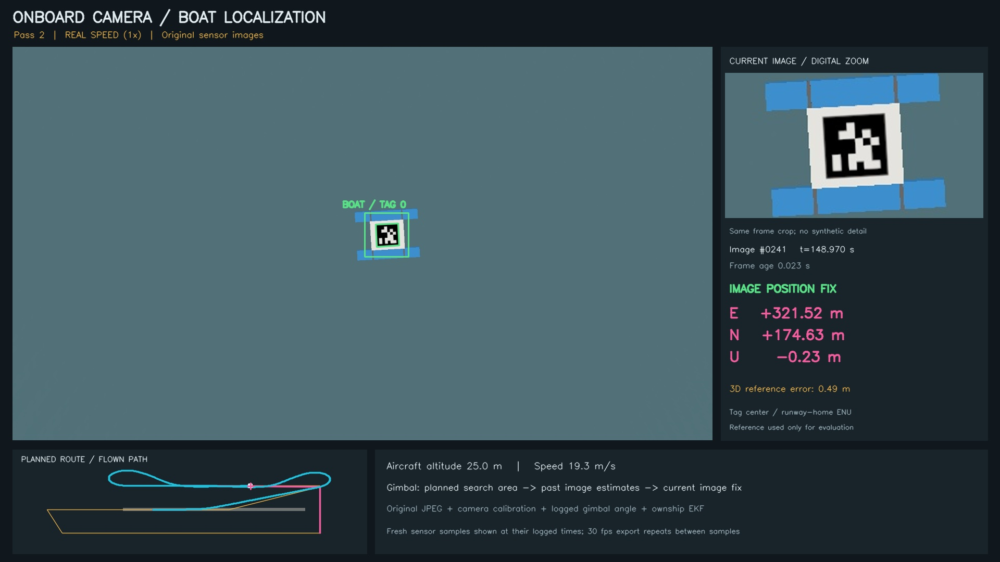

# BlueBoat air-sea simulation for Gazebo Harmonic

The [mutual observation and classical speed coordination extension](docs/COOPERATIVE_20261112.md)
adds a boat upward camera, aircraft belly AprilTag, shape/tag filtering,
bounded feedback speed changes for both SITL vehicles and a live dual-camera
telemetry display. It retains the existing takeoff and runway recovery.
Run `./RunCooperative.ps1` in PowerShell after the setup/import steps, or
`bash tools/run_cooperative_wsl.sh --out "$PWD/results/cooperative_run_01"`
on Ubuntu/WSL. Each new trial requires its own independent validation.

The final 70 s cooperative run passed 38/38 checks, with fresh image coverage
99.99% (aircraft to boat) and 98.88% (boat to aircraft). Position error P95
was 1.05 / 5.24 m; aircraft target velocity remains coarser at 5.92 m/s P95.
See [measured evidence](docs/evidence/cooperative_20261112/validation_summary.json)
and [physical flight paths](docs/evidence/cooperative_20261112/Flight_Paths.png).



Fixed-wing coastal search, image-based boat localization and autonomous
runway recovery in Sea State 1, built on the BlueBoat simulation below.
The aircraft uses real ArduPlane 4.6.3 native aerodynamic/ground-contact
physics, coupled to the Gazebo scene and onboard camera. The boat uses
Gazebo six-DOF dynamics and ArduRover 4.7.2.

Aircraft appearance: an original MIT-licensed swept-wing Coastal EDF UAV,
1.15 m long and 1.6 m in span, with an enclosed propulsion duct and no
exposed propellers. Native ArduPlane aerodynamic and propulsion FDM remains
generic; this is not a calibrated EDF or jet aircraft model. The earlier
[PX4 Believer assets](assets/aircraft/believer/NOTICE.md) remain attributed.



**Start here:** [fixed-wing setup, mission, evidence and model limits](docs/AIRSEA_NEXT_PHASE.md).

For the user's existing detailed BlueBoat model, use the
[original-model import and verification](docs/ORIGINAL_BOAT_RESTORED_20261110.md).
Public checkouts contain the procedural boat. Local demonstrations with
the imported CAD select and verify that original model explicitly; an
asset failure stops the run instead of substituting a different boat.



The [camera capture workflow](docs/CAMERA_CAPTURE_20261110.md) replaces the
brief fixed-downward view with an image-directed virtual gimbal. The restored
original-model revision uses 24 degree optics and a lateral second survey
corridor to reduce antenna occlusion. The live display exposes the onboard camera, and a camera-first
video export links original sensor images, same-frame zoom, current ENU
estimates and the flown path. The independent validator checks sustained
detections and reconstructs gimbal pointing from prior images.

The restored original-model mission `airsea_original_boat_20261110_03`
passed all 34 independent checks, including actual world visuals,
original mesh hashes, full takeoff/landing and both image survey passes.
It yielded 69 image fixes, with accepted intervals of 3.444 / 2.352 s
and 3D tag-center position error P95 0.966 m. Raw survey-window pitch-rate
P95 was 1.555 deg/s. [Validation](docs/evidence/original_boat_20261110/validation.json)
and [video checks](docs/evidence/original_boat_20261110/encoded_video_checks.json)
are included. [Corrected videos and source](https://github.com/shepherd-p/blueboat-airsea-sim/releases/tag/original-blueboat-2026-11-10)
replace the earlier procedural-boat presentation.



The earlier procedural-boat mission on 2026-11-10 passed 29 checks, with 64 image
fixes, sustained detection intervals of 2.772 / 2.604 s, and 3D position
error P95 of 0.924 m. [Historical camera validation](docs/evidence/camera_20261110/validation.json)
and [video provenance](docs/evidence/camera_20261110/camera_video_checks.json)
are included. The earlier 2026-11-08 evidence below is retained as history.



The fresh EDF-visual run on 2026-11-08 passed all 25 independent checks:
autonomous runway takeoff, two image survey passes, image-based second-pass
waypoint update and autonomous landing/stop/disarm. Image position error P95
was 0.935 m (12 detections: 8/4 across the two passes); touchdown descent
speed was 0.837 m/s. Revised pitch control removed the old sustained
oscillation: search-window pitch-rate P95 fell from 61.075 to 1.554 deg/s.
The review video adds a causal flown-trajectory map, original sensor-image
fixes, ENU boat estimates and separately labeled evaluation errors. See
[the revision and reproduction notes](docs/REVISION_20261108.md).
See [validation provenance](docs/VALIDATION_HISTORY.md) and
[current machine-readable evidence](docs/evidence/edf_20261108/validation.json).

Clean videos, a source snapshot and the original image/flight evidence archive
are distributed as [release attachments](https://github.com/shepherd-p/blueboat-airsea-sim/releases/tag/airsea-edf-stable-2026-11-08).

For smooth 1080p/30 fps presentations, use the separately labeled
[trajectory replay workflow](docs/RECORDING_30FPS.md). It renders each frame
from the recorded aircraft and boat physical states. Original sensor/flight
evidence remains separate; video container fps alone does not prove smoothness.

```bash
# After the baseline build/install steps below:
bash tools/setup_sitl_wsl.sh
bash tools/setup_plane_sitl_wsl.sh
bash tools/build_airsea_wsl.sh
bash tools/run_airsea_wsl.sh --out "$PWD/results/airsea_run_01" --rtf 0.8
python3 tools/airsea/validate.py --out "$PWD/results/airsea_run_01"
```

Validation reports distinguish native flight-only tuning, camera pilots and
complete coupled missions. No real-world flight or vessel calibration is
claimed. Binary firmware, manufacturer CAD and private meeting material
are not distributed.

## BlueBoat baseline

BlueBoat modeling, wind/waves/current, ROS 2 control, ArduRover SITL and
image-based AprilTag six-DOF measurement, developed as additions to H-SPAR.

**Ubuntu 24.04 · ROS 2 Jazzy · Gazebo Harmonic · OpenCV 4.6.** The public
distribution runs with a procedural twin-hull appearance and original
procedural water textures. Manufacturer CAD shown in the demonstration
videos is an optional local asset and is not redistributed here.

## Install and build

Install ROS 2 Jazzy following its official installation instructions, then:

```bash
sudo apt update
sudo apt install ros-jazzy-ros-gz ros-jazzy-gz-sim-vendor \
  ros-jazzy-gz-plugin-vendor ros-jazzy-gz-gui-vendor \
  ros-jazzy-gz-rendering-vendor ros-jazzy-gz-transport-vendor \
  python3-colcon-common-extensions python3-numpy python3-pil \
  python3-matplotlib python3-opencv libopencv-dev libopencv-contrib-dev \
  qtbase5-dev qtdeclarative5-dev cmake g++ ffmpeg curl
bash tools/build_public_wsl.sh
```

The build creates meshes/assets, all three ROS packages and all native
camera plugins. WSL2/WSLg and native Ubuntu are supported. A working OpenGL
desktop is needed for graphical recording; headless physics tests do not
need a GUI. Python OpenCV 4.6 from Ubuntu packages is the tested API.

## Run Sea State 1 without installing firmware

```bash
bash tools/demo_public_wsl.sh
# In a second shell, from the same project directory:
ROS_DOMAIN_ID=73 GZ_PARTITION=blueboat_standalone bash tools/command_wsl.sh 0.4 0 5
```

The model otherwise floats/drifts under the selected waves, wind and current.
The sea-state profiles are representative linear JONSWAP realizations,
not coverage of an entire sea-state class. Sea State 1 is the default here.

## Real ArduRover firmware and fixed-camera pose display

```bash
bash tools/setup_sitl_wsl.sh     # separate pinned download; not shipped
bash tools/fixed_camera_6dof_wsl.sh 1 full
python3 tools/validate_fixed_camera_6dof.py \
  --out results/fixed_camera_6dof_20261102/state_1_full
```

This opens a live native camera panel with x/y/z and roll/pitch/yaw, then
records wave-driven drift and a steering sequence. The camera stays fixed
at world [7.5,-1,5] m. Pose uses AprilTag36h11 ID0 image corners, known
0.432 m black-border size and calibrated pinhole intrinsics. Truth is used
only for validation. Optical axes are x right, y down, z forward; the
bottom line transforms the estimate into world coordinates. Single planar
tag ambiguity and real-camera calibration/noise/blur remain limitations.

Arming checks/EKF remain enabled; allow 40 simulation seconds for settling.
Capture slows wall-clock execution while preserving physics steps; videos
follow simulation timestamps. A capture directory is never overwritten.
The same tools accept `2` for the previously implemented Sea State 2 case.

## Verification

```bash
bash tools/validate_wsl.sh
python3 tools/check_buoyancy_conditioning.py
bash tools/validate_propulsion_wsl.sh
bash tools/validate_environment_wsl.sh
# With the separately installed SITL runtime:
bash tools/validate_sea_states_wsl.sh
```

The public visual changes leave physics source/config values intact. Previous
CAD-based evidence and the fresh public fixed-wing run are distinguished
in docs/VALIDATION_HISTORY.md.

## Optional manufacturer CAD

The CAD archive did not include an explicit redistribution license, so no
manufacturer STL/rotor geometry is shipped. Obtain it directly from Blue
Robotics under the applicable terms, and keep it local:

https://cad.bluerobotics.com/BLUEBOAT_120_BR-101447_RevA_PUB.zip

Place the archive in `references/blueboat_cad_official.zip`, install optional
CAD tools (`trimesh`, `fast-simplification`), then run `tools/prepare_cad.py`.
Rotor splitting is available as `python3 -c "import sys; sys.path.insert(0,
'tools'); from prepare_visual_assets import rotors; rotors()"` (one line).
Regenerate/rebuild afterwards. CAD files are ignored by Git. The complete
legacy `prepare_visual_assets.py` also downloads third-party Fuel binaries;
that download is optional and its output is not part of this public release.

## Model limits

Mass, center of mass, inertia and drag are engineering approximations.
Propeller RPM is a static 16 V manufacturer-data mapping, not calibrated
underway RPM. Waves are linear/deep-water; no breaking/slamming/wake CFD,
final sensor rig or real-vessel calibration is claimed. The landing panel
is visual only: no structure, payload or UAV touchdown capacity is implied.

## Source and licensing

Base H-SPAR repository: https://github.com/naviiidz/h-spar-sim
commit `2fb6b980e224c220e5c15a696a9933b7448f0ad8`.
This standalone subset contains three ROS packages and the tools needed by
the BlueBoat demonstrations. It is not the complete upstream planner suite.

Original project additions: MIT, except separately marked derived files.
Gazebo buoyancy and UUV water shaders retain Apache-2.0 notices. Existing
ROS package licenses/source headers apply. See LICENSE, LICENSES/ and
THIRD_PARTY_NOTICES.md. ArduPilot/OpenCV/ROS/Gazebo are external dependencies.

Videos, private correspondence, machine logs, build caches and manufacturer
CAD are outside the GitHub source tree. See docs/ROADMAP.md for future work.
