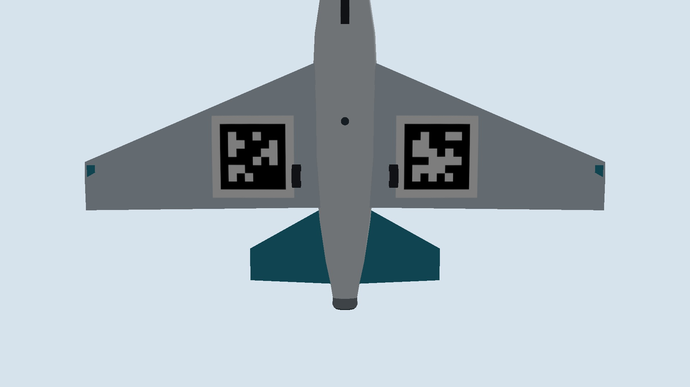
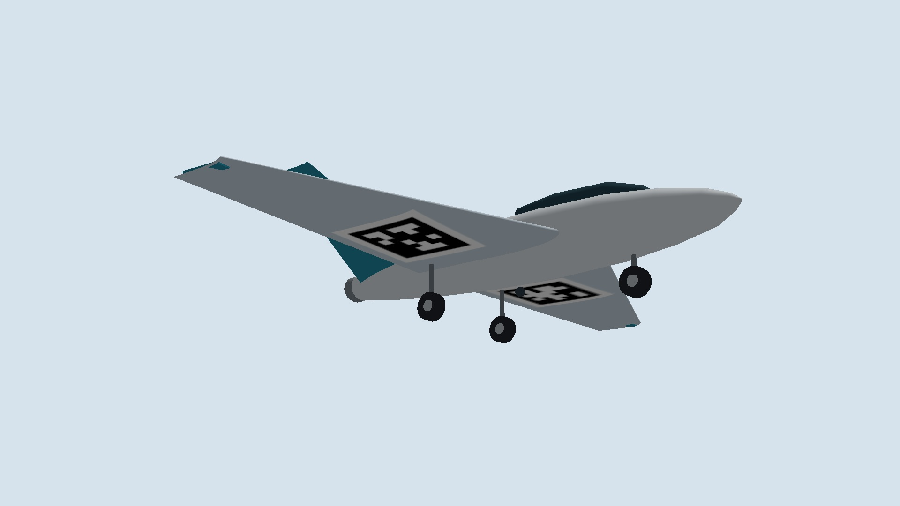

# AprilTags integrated into the existing wing skin

The previous aircraft carried a 0.35 m outer square below a fuselage only
about 0.20 m wide. A separate board in that position was an unsuitable
installation concept. It has been removed from the cooperative world.

The replacement is a smooth painted marking, or a thin conforming film
subject to airframe approval, on each main-wing underside. AprilTag36h11
IDs 1 and 2 have 0.20 m black squares and 0.25 m outer quiet zones.
Their centers are at body XY (-0.105, +0.28) and (-0.105, -0.28) m.
They fit within the existing wing, clear of its edges. No extra plane,
standoff, board, collision surface, mass or aerodynamic surface is added.
Both the code and its white quiet zone use the wing's existing triangles.





## Geometry and rendering checks

The wing vertices and geometric triangle set match the previous accepted
airframe exactly. The old generator had inward face winding: near surfaces
were culled and the opposite skin could show through. Winding and normals
are now outward; this changes rendering, not the airframe shape.
The initial underside UV convention also mirrored the codes. An actual
render/decode check exposed this and the texture orientation was corrected.
No mirrored camera images are supplied to the flight estimator.

The first flight trial was stopped after finding that mirrored texture.
The second exposed an existing startup association failure: a noisy
long-range boat velocity estimate drifted outside a fixed 5 m association
gate, so visible boat images were rejected until a tag appeared. The gate
now includes the filter's predicted XY covariance as well as a target-motion
envelope. Blank-image, foreground-distractor, loss/recovery, scale, timing
and curved-corner regression checks pass (10 tests). Failed trial logs
remain in `results/cooperative_skin_20261113_01` and `_02`; neither is the
accepted flight demonstration.
The third launch (`_03`) failed during WSL D3D12/OpenGL initialization,
before any camera pairs were produced. A clean retry uses the same code
and parameters; this graphics startup failure is retained in its logs.

`aircraft_skin_tags.json` records final textured mesh hashes, texture
hashes, pre/post-paint geometry hashes, and the actual skin coordinates of
each corner. The older `aircraft_visual.json` mesh hashes describe the
base meshes before their UV/material paint pass; use the skin manifest
for the final wing files.

The complete white borders are checked against the original triangulated
lower skin. Corner nonplanarity is about 0.61 mm. The middle of a painted
edge also follows the curved skin; this remains an approximation when a
four-corner detector locates the code. Surface roughness, deformation and
real optical calibration have not been modeled.

Both IDs decode from the unmodified native Gazebo close-up. With the known
inspection camera, aircraft-origin translation errors are 0.01135 and
0.01126 m. These are close-up calibration checks, not operational accuracy
claims. See `evidence/skin_tags_20261113/inspection_checks.json`.

## Position estimation and optics

For wing tags, the estimator fits translation to calibrated nonplanar
3D skin corners, using the already-declared communicated aircraft IMU
attitude. It returns the aircraft body origin; the off-center marker is
not mistaken for the aircraft center. It does not read target position
or ground-truth attitude. Missing attitude disables this tag update.
The deck tag on the boat retains the existing planar-square solver.

## Accepted full flight

`cooperative_skin_20261113_04` passed **44/44 independent checks** after
ordinary arming, autonomous takeoff, coordinated cruise, return, runway
landing, stop and automatic disarm. Ten behavioral regression tests pass.
All 931 original camera pairs reproduce the live estimator output.
The 70.000 s coordinated interval contains 804 independent image pairs
at a measured mean 11.488 Hz.

| Measured outcome | Aircraft observing boat | Boat observing aircraft |
| --- | ---: | ---: |
| Fresh visual measurement time | 99.977% | 98.863% |
| Longest measurement gap | 0.094 s | 0.350 s |
| Position error P95 | 1.169 m | 4.502 m |
| Tag observations | 29 | 28 |
| Shape-only maximum range | 104.579 m | 104.360 m |

Both wing IDs were decoded: ID 1 in 16 frames and ID 2 in 12 frames.
The maximum accepted wing-tag range was 55.705 m; this is an observed
value in one trial, not a guaranteed detection range. Airborne-target
velocity error P95 was 6.007 m/s, so velocity estimation remains coarse
during turns. No upward EKF reacquisition cue was needed during cruise;
initial acquisition and communicated IMU assistance remain declared inputs.

Both vehicles' commanded and physical speeds varied. Boat command range
was 0.449–1.251 m/s; independent Gazebo position differences reached
1.250 m/s, with navigation/physics speed disagreement P95 0.031 m/s.
Touchdown sink speed was 0.873 m/s. These thresholds are local engineering
checks, not formal professor-provided acceptance criteria.

See [validation metrics](evidence/skin_tags_20261113/validation_summary.json),
[actual paths](evidence/skin_tags_20261113/Flight_Paths.png) and
[speed/error plots](evidence/skin_tags_20261113/Coordination_And_Visual_Errors.png).
The clean exports contain no text or boxes. All exports use 30 fps
containers repeating the original 11.488 Hz samples without synthetic
optical-flow frames.

The smaller aircraft markings use a 14 degree upward-camera horizontal
field of view, replacing the previous 20 degrees, at the same 1920 x 1080
resolution. This is a changed optical requirement, not digital enhancement
or free magnification. At 70 m, an ideal frontal 0.20 m code spans about
22 pixels; oblique views reduce this. The shape estimator continues when
neither tag can be decoded. A real implementation needs suitable optics,
gimbal pointing, exposure and vibration performance; none has been proven
on hardware here.

## Reproduction

After the setup and original-boat import in `README.md`:

```bash
bash tools/build_airsea_wsl.sh
bash tools/preview_aircraft_wsl.sh --skin-tags --out "$PWD/results/skin_inspection_01"
python3 tools/cooperative/inspect_skin.py --out "$PWD/results/skin_inspection_01"
bash tools/run_cooperative_wsl.sh --out "$PWD/results/skin_flight_01" --rtf 0.95
python3 tools/cooperative/validate.py --run "$PWD/results/skin_flight_01"
```

Use a fresh output directory for every run. On Windows, `RunCooperative.ps1`
starts the flight and runs its independent acceptance check.

## Physical scope

Paint applied to the existing skin is a more plausible installation than
an exposed board. This model does not demonstrate zero aerodynamic impact:
film/paint thickness, adhesion, surface finish, wing structural details,
mass balance and local boundary-layer effects require physical airframe
engineering and, where necessary, aerodynamic testing. The aircraft FDM
remains generic ArduPlane SITL; it is not CFD or an airworthiness result.

The restricted known-silhouette/uniform-sky baseline and ideal image/gimbal
limitations in `COOPERATIVE_20261112.md` still apply. Historical results
and videos from November 12 show the previous board and are not evidence
of the corrected installation.
